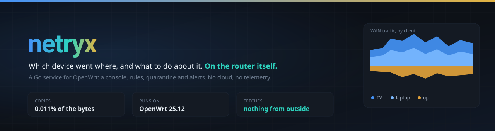
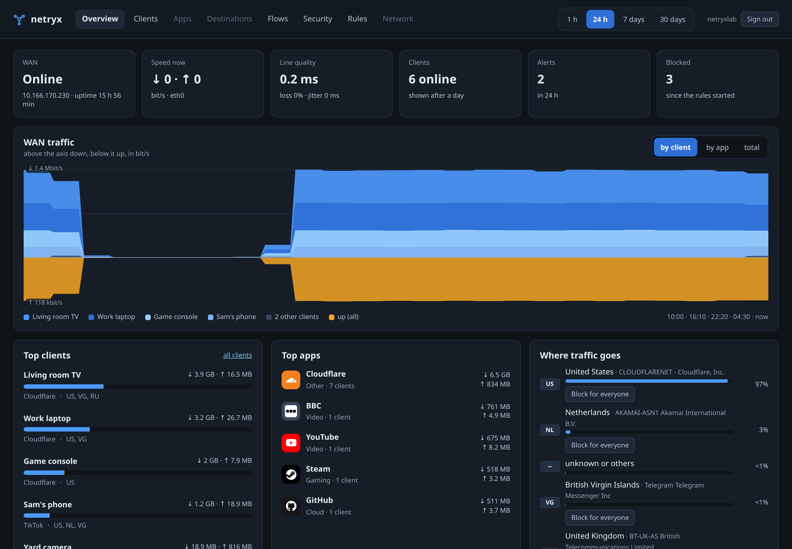
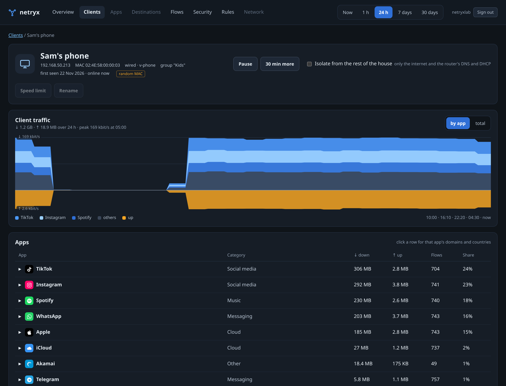
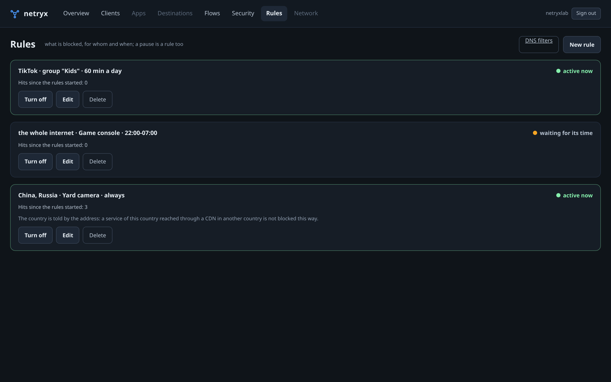
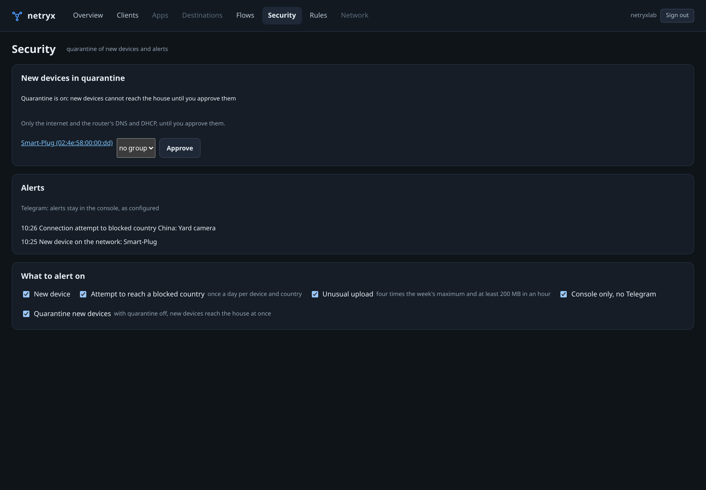
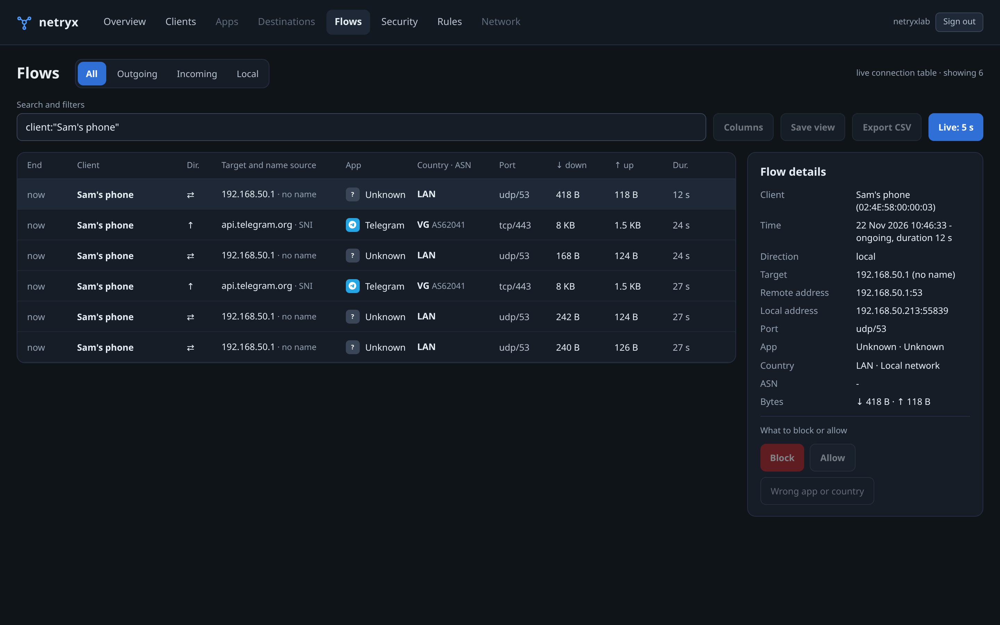
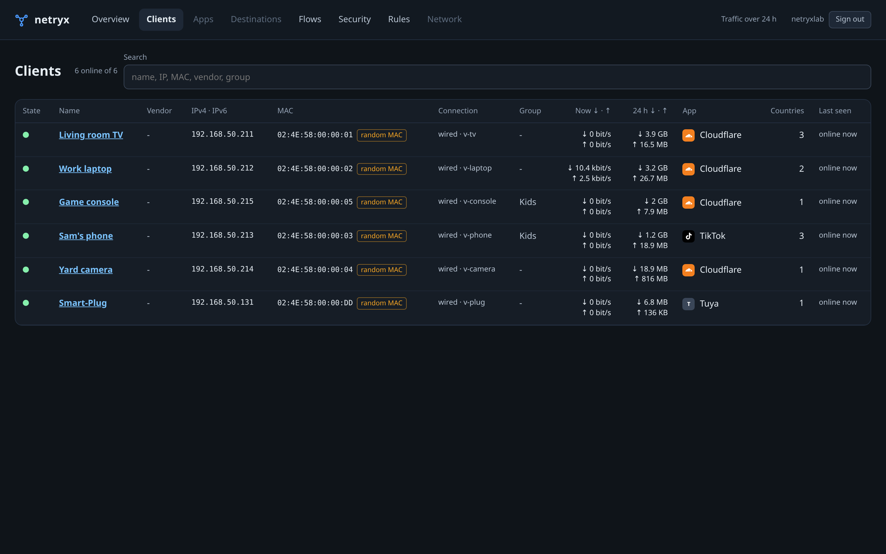

<div align="center">



# netryx

A home network console that runs **on** the OpenWrt router, not beside it: which device went
where, what each app is, and what to do about it. Rules, time limits, quarantine for new devices
and alerts, with no cloud and no telemetry.


[](LICENSE)

</div>



<sub>Every screenshot here is the real console on an OpenWrt 25.12 router in a lab, with a
synthetic house: five devices in network namespaces with the habits of a TV, a laptop, a phone, a
camera and a game console, on the real internet. The names, addresses and MACs are made up.</sub>

## What it does

- **Who is on the network, and what they do.** Every device by its hardware address, with its
  name, vendor, address, how it is connected, and its traffic by app, by country and by network,
  live and over an hour, a day, a week or a month.
- **Apps, not ports.** A connection is named by the name the device asked for: the TLS handshake,
  QUIC, and the router's own resolver when the handshake hides it. About 260 apps (TikTok,
  YouTube, Netflix, Steam, WhatsApp...) are told apart, each with its icon.
- **Rules.** Block an app, a category, a country or the whole internet, for one device or a
  group, at certain hours and days, or until a time. A **time limit** gives an app so many
  minutes a day and blocks it until midnight once they are used. "30 more minutes" is one tap.
- **New devices wait outside.** With quarantine on, a device the router has never seen gets the
  internet and nothing of the house until you approve it. A camera or a TV can be **isolated**
  from the rest of the house for good.
- **Alerts.** A new device, a try to reach a blocked country, an unusual upload: in the console,
  and through a Telegram bot if you have one.
- **DNS filters.** Force the house's DNS through the router, block DNS over TLS and HTTPS, safe
  search for a group, and switch adblock-fast lists.
- **For your monitoring.** `/metrics` in the Prometheus format, `/api/snapshot` as JSON, and
  Zabbix low-level discovery.
- **For a router agent.** [Hermes](https://github.com/TAIPANBOX/hermes-openwrt) reads netryx over a
  read-only ubus object and writes rules as UCI sections under a rollback
  ([docs/agent.md](docs/agent.md)).

| | |
|---|---|
|  |  |
| **A device**, here a phone over 24 hours, by app | **Rules**, a time limit, a bedtime and a country block |
|  |  |
| **Security**, a newcomer in quarantine and the alerts | **Flows**, every live connection, searchable |



## How it sees traffic without copying it

netryx copies **only the start of a connection, and only when it can be named.** The selection is
by what a packet is, not by whether its flow is new: a TLS record that opens a ClientHello, or a
QUIC long header on udp/443. That packet opens a budget of three packets for its flow, sized to a
ClientHello with post-quantum key shares, and then nothing more is copied.

On a Flint 2 (MT7986, OpenWrt 25.12.5), 20 MB of ordinary traffic plus three TLS handshakes
crossed the bridge: 6507 packets and 21.43 MB seen, **9 packets and 2388 bytes copied**, 0.011% of
the bytes. The counters are in the nftables rule itself, so you can read them on your own router:

```
nft list chain netdev netryx observe
```

It hangs on the **ingress hook of the bridge's member ports**. With flow offloading on, an
established flow stops passing the forward hook and a monitor there goes blind; at ingress the
handshake is seen first, with the device's own hardware address and an address not yet through
NAT. A port that disappears, as every `wifi reload` does, is noticed and attached again.

Bytes come from conntrack, counted once: a dump that races a destroy, a flow first met in a dump
and a reused key are each counted exactly once, and what a full table pushes out is reported as
lost rather than guessed.

**Encrypted Client Hello** hides the name in the handshake, so netryx also reads the router's own
resolver: the questions devices ask and the answers it gives, believed only from the router
itself. Each name in the console says how it was learned. That is the most personal part, and it
is one setting: `uci set netryx.main.passive_dns='0'`.

## Measured

On real routers and a lab, each figure with the command that produced it in
[docs/flint2-measured.md](docs/flint2-measured.md) and the `docs/*-measured.md` files.

| | |
|---|---|
| Copied of what crossed the bridge | 9 packets and 2388 bytes of 21.43 MB (0.011%) |
| Rules enforced on a Flint 2 | with flow offloading off, the software flowtable and the hardware flowtable setting, Wi-Fi clients, one reboot |
| Console bytes against the line's own counters | within -0.14% to -1.78% |
| Memory on a Flint 2 (1 GB) | 133 to 135 MB under load; the heaviest apply, every country blocked at once, peaks at 158 MB with the default `memory_limit` of 160 MiB (242 MB without it) |
| Every country blocked | 296 384 set elements, 44 MB of kernel memory |
| Flash written | about 3.4 MB a day for a profile of 30 busy devices: one file per closed hour and per closed day |

## Install

netryx is a Go binary and one package for OpenWrt 25.12 (`apk`). It pulls in the kernel modules
it needs (`kmod-nf-conntrack-netlink`, `kmod-nfnetlink-log`, `kmod-nft-bridge`) and `nftables`.

Build the package from this repository (Go 1.27, Node for the console page, Docker for `apk mkpkg`):

```
sh scripts/fetch-data.sh data               # address table, vendor list, v2fly lists, Simple Icons
go run ./tools/appmap -v2fly data/v2fly/data -catalog tools/appmap/catalog.tsv \
    -o data/appmap.tsv -meta data/apps-meta.json
go run ./tools/iconpack -si data/simple-icons/icons -meta data/apps-meta.json \
    -out internal/web/dist/icons
sh package/netryx/build.sh aarch64_cortex-a53   # builds the console page, then the binary
sh package/netryx/mkapk.sh aarch64_cortex-a53
```

Copy it to the router and install it:

```
apk add --allow-untrusted netryx-0.1.0-r1.apk
netryx check                                # asks the kernel whether this router can run it
/etc/init.d/netryx start
```

`netryx check` dry-runs the exact ruleset through the kernel without touching the running
firewall, reports the flow-offloading setting, and names what is missing by its cause.

The console listens on `127.0.0.1:8788` by default and signs you in with your LuCI account. Reach it
through SSH, `ssh -L 8788:127.0.0.1:8788 root@192.168.1.1`, then <http://127.0.0.1:8788/>, or set
`netryx.main.listen` to the router's LAN address. Everything else is in `/etc/config/netryx`, each
option explained where it stands.

Architectures: `aarch64_cortex-a53`, `aarch64_generic`, `x86_64`, `arm_cortex-a7`/`a9` and `mips`
build from the same script (`build.sh` maps the OpenWrt name to Go's).

## Security

- **The page fetches nothing from outside the router.** A strict Content-Security-Policy allows
  only the router itself, brand icons are built into the binary or fetched once by the router
  from the brand's own site, and a device's own name cannot bring markup onto the page.
- **Every view needs a LuCI session**, every change also its CSRF token, and the cookie is an
  opaque handle, never the rpcd session. Logins are rate limited.
- **Only the router's own names reach it.** A request with any other Host header (a rebound DNS
  name, the WAN address) gets 421.
- **Rules outlive the process and fail closed.** The ruleset is one nftables table applied in one
  transaction, kept when netryx stops and loaded again at boot; a ruleset the kernel refuses leaves
  the previous one in force, and a missing data file never opens what was blocked.
- **The agent reads, and changes only its own.** The ubus object `netryx` has six methods, all
  reads; an agent's rule is a UCI section named `agent_*` under openwrt-mcp's rollback, and it
  cannot touch the owner's rules, the DNS filters, the quarantine or the alerts.
- **The Telegram token** is read from Hermes's root-only file only when sending, refused if anyone
  else can read it, and never written to a log or an error.

## Limits by design

- Ingress on the LAN ports sees the house-to-internet direction, so a knock arriving from the
  internet is not in this picture.
- QUIC Initial packets are named by the resolver, not decrypted.
- Once hardware offload has programmed a flow, its packets never reach the CPU. The handshake has
  passed by then; a late one, such as STARTTLS, is not seen.
- A device behind a second router or a 3-address repeater arrives as one MAC.
- A Wi-Fi device is isolated from its SSID neighbours only when the SSID isolates clients itself;
  the console says so on the device.

## How it is tested

Every test is run against the broken code first and must fail there. Every gate in `scripts/` has
a case in `scripts/gates-have-teeth.sh` that plants its own fault and requires the failure, and the
scenarios in `features/` are bound both ways to named tests by `scripts/scenarios-bound.sh`. The
invariants and the test that holds each one are listed in [CLAUDE.md](CLAUDE.md).

## License

MIT, see [LICENSE](LICENSE). The data files a package carries come with their own licences in
`/usr/share/netryx/NOTICE`: the address table from iptoasn.com (public domain), the IEEE vendor
list, the v2fly domain list (MIT) and Simple Icons (CC0).
